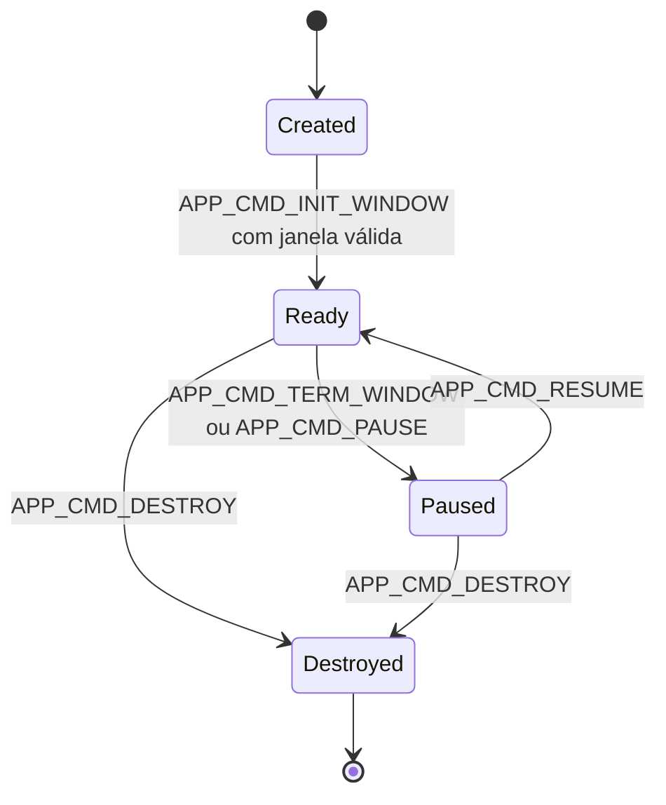

# Guia completo do `nativeapp::App`

> **Fonte de verdade**: `include/nativeapp/app.hpp`, complementado por
> `include/nativeapp/graphics_types.hpp`, `include/nativeapp/assets.hpp`,
> `include/nativeapp/text_input.hpp`, `include/nativeapp/permissions.hpp`,
> `include/nativeapp/input_helpers.hpp` e pelos exemplos
> `examples/nativeapp-gl/jni/main.cpp`,
> `examples/nativeapp-advanced/jni/main.cpp` e
> `examples/permissions-test/jni/main.cpp`.
>
> Todo comportamento aqui descrito existe no código. Quando o texto tira uma
> consequência do código (em vez de transcrever um comentário), isso aparece
> como **Observação**.

---

## 1. Visão geral: o que o `App` resolve

`nativeapp::App` é a classe base C++ do apkfast para aplicações
**NativeActivity** sem Java. Você herda dela, sobrescreve os callbacks que
precisa e termina o arquivo com a macro `APP_MAIN(MinhaClasse)`.

```cpp
#include <nativeapp/nativeapp.hpp>   // umbrella: inclui app.hpp + gl.hpp + vk.hpp + ...
// ou, de forma direta:
// #include <nativeapp/app.hpp>      // puxa assets, graphics_types, input_helpers,
//                                   // permissions, permissions_jni e text_input
```

Ele existe para que você **não precise reescrever o "glue" do Android em todo
projeto**. Concretamente, o `App` cuida de quatro frentes:

| Frente | O que o `App` faz no código |
|---|---|
| **Looper** | Em `run()`, instala `app_->userData = this`, registra `app_->onAppCmd = &App::on_app_command_thunk` e `app_->onInputEvent = &App::on_input_thunk`, e roda `ALooper_pollOnce(0, ...)` em loop até `state_ == Lifecycle::Destroyed` ou `app_->destroyRequested`. |
| **Ciclo de vida** | Mantém `Lifecycle`, `paused_`, `focused_`, `initialized_` e `surface_active_`; converte `APP_CMD_*` em `on_ready()`, `on_surface_created()`, `on_surface_changed()`, `on_surface_destroyed()`, `on_pause()`, `on_resume()` e `on_destroy()`. |
| **JNI** | Injeta o `AAssetManager` no singleton `Assets`, inicializa o `TextInput` com o `JNIEnv*` da UI thread, chama `Permissions::update()` e `notify_activity_result()` nos momentos certos e desliga as refs globais de `Permissions`/`JniPermissions` no `finish()`. |
| **Input** | Traduz `AInputEvent` de teclado e toque em `on_key()` / `on_touch()`, mantém os conjuntos `keys_down_` e `touches_down_` para polling, alimenta o `InputHelpers` e repassa teclas ao teclado virtual quando ele está aberto. |

**Por que ele existe:** sem essa camada, cada app nativo teria que implementar
manualmente o despacho de comandos da `android_app`, a bomba de eventos, o
tratamento de janela recriada após rotação/background, o cálculo de `dt` e a
ponte com o JNI. O `App` centraliza tudo isso e deixa apenas os *hooks* de
jogo (`on_ready`, `on_update`, `on_draw`, `on_touch`, ...).

> **Observação:** a interface `Scene` mencionada neste guia está em
> `graphics_types.hpp`. Ela é o contrato que permite trocar o backend
> (`GLES2Scene`, `VulkanScene`) sem mudar a lógica do app.

---

## 2. Diagrama do ciclo de vida

Os estados são declarados em `app.hpp`:

```cpp
enum class Lifecycle {
    Created,    ///< android_main iniciou, sem janela ainda
    Ready,      ///< janela ativa, renderizando
    Paused,     ///< em background (janela pode ter sido destruída)
    Destroyed,  ///< APP_CMD_DESTROY recebido
};
```



Versão compacta em texto:

```text
  Created -- INIT_WINDOW (janela válida) --> Ready -- TERM_WINDOW / PAUSE --> Paused
     |                                       ^                                  |
     |                                       +---------- RESUME ----------------+
     +------------------ DESTROY --------------------------------------------> Destroyed
                                                                                  |
                                                                        finish() -> on_destroy()
```

### 2.1 O que acontece em cada transição

O `run()` começa com `state_ = Lifecycle::Created`, `last_frame_ =
steady_clock::now()` e processa os comandos recebidos pelo `onAppCmd`:

| Comando Android | Ação interna do `App` | Callbacks disparados |
|---|---|---|
| `APP_CMD_INIT_WINDOW` | `activate_surface()`: exige `app_->window != nullptr` e largura/altura > 0; guarda `native_window_`, `width_`, `height_`. Na primeira vez, injeta `Assets`, inicializa `TextInput`, chama `on_ready()` e muda para `Ready`. Se a surface é nova, marca `surface_active_ = true` e notifica dimensões. | `on_ready()` (uma vez), `on_surface_created()`, `on_surface_changed(w, h)` |
| `APP_CMD_TERM_WINDOW` | `deactivate_surface()` zera `native_window_` **antes** do callback; se `state_ == Ready`, passa para `Paused`. | `on_surface_destroyed()` (se `surface_active_`) |
| `APP_CMD_WINDOW_RESIZED` | Atualiza `native_window_` e, se `w`/`h` > 0 e diferentes dos atuais, atualiza `width_`/`height_`. | `on_surface_changed(w, h)` |
| `APP_CMD_WINDOW_REDRAW_NEEDED` | Mesmo tratamento de redimensionamento acima. | `on_surface_changed(w, h)` se as dimensões mudaram |
| `APP_CMD_PAUSE` | `paused_ = true`. | `on_pause()` |
| `APP_CMD_RESUME` | `paused_ = false`; reinicia `last_frame_`; avisa o subsistema de permissões; se estava `Paused`, volta para `Ready`; chama `activate_surface()` de novo, porque a janela pode ser nova. | `Permissions::notify_activity_result()`, `on_resume()`, depois `on_surface_created()` / `on_surface_changed()` se a janela voltou |
| `APP_CMD_GAINED_FOCUS` | `focused_ = true`; se houver janela válida, chama `activate_surface()`. | `on_surface_created()` / `on_surface_changed()` se a surface for nova |
| `APP_CMD_LOST_FOCUS` | `focused_ = false`. | nenhum |
| `APP_CMD_DESTROY` | `deactivate_surface()` e `state_ = Lifecycle::Destroyed`. O loop de `run()` sai e chama `finish()`. | `on_surface_destroyed()` (se ativa), depois `on_destroy()` |

Comandos não listados caem no `default: break;` — são ignorados.

### 2.2 O sub-ciclo da surface

A janela nativa pode nascer e morrer **várias vezes** enquanto o app vive
(rotação, background, diálogo de permissão). Cada nascer/morrer dispara
`on_surface_created()` / `on_surface_destroyed()`.

Dois detalhes importantes do código:

1. `activate_surface()` calcula `is_new = (native_window_ != app_->window) ||
   !surface_active_` **antes** de atribuir o ponteiro. Por isso, quando a
   surface é nova, o `App` chama `on_surface_created()` e, logo em seguida,
   **`on_surface_changed(width_, height_)` mesmo que as dimensões não tenham
   mudado**. É por isso que os exemplos confiam no `on_surface_changed()` para
   configurar a projeção/viewport.
2. `deactivate_surface()` zera `native_window_` antes de chamar
   `on_surface_destroyed()`, justamente para que `window()` não devolva um
   ponteiro inválido durante a destruição.

### 2.3 Quando um frame acontece

O bloco de frame dentro de `run()` só é executado quando as três condições são
verdadeiras:

```cpp
if (state_ == Lifecycle::Ready && native_window_ && !paused_) {
    // on_tick -> on_update -> [begin_frame] -> on_draw -> [present] -> frames++
}
```

Ou seja: `on_update()` e `on_draw()` **não** são chamados em background, sem
janela ou com `paused_ == true`. Note que `is_ready()` usa exatamente a mesma
ideia: `state_ == Lifecycle::Ready && !paused_`.

---

## 3. Tabela completa de métodos públicos

Todos os métodos públicos declarados em `App` (a assinatura é a real do
cabeçalho; nomes de parâmetros omitidos no `app.hpp` foram mantidos omitidos):

| Assinatura real | Categoria | Descrição |
|---|---|---|
| `explicit App(android_app* app)` | Construção | Guarda o `android_app*` em `app_`. É o único construtor; a macro `APP_MAIN` passa o `app` recebido pelo `android_main`. |
| `virtual ~App() = default;` | Construção | Destrutor virtual padrão. |
| `int run()` | Execução | Instala os thunks de comando/input, inicializa o estado e o relógio, roda o looper e o loop de frames. Retorna `0` ao sair (tanto no caminho `destroyRequested` quanto no fim do loop). |
| `void finish()` | Execução | Desliga `Permissions` e `JniPermissions` (com argumentos `nullptr`) e **depois** chama `on_destroy()`. É chamado pelo próprio `run()` na saída. |
| `Lifecycle lifecycle() const` | Estado | Devolve o estado atual da máquina (`Created`, `Ready`, `Paused`, `Destroyed`). |
| `bool is_ready() const` | Estado | `true` se `state_ == Lifecycle::Ready && !paused_`. |
| `ANativeActivity* activity() const` | Estado | Devolve `app_->activity` (útil para `Permissions::instance(activity())`). |
| `android_app* native_app() const` | Estado | Devolve o `android_app*` original. |
| `ANativeWindow* window() const` | Estado | Devolve `native_window_`, que é `nullptr` quando não há surface ativa. |
| `int width() const` | Estado | Largura atual da janela, lida com `ANativeWindow_getWidth`. |
| `int height() const` | Estado | Altura atual da janela, lida com `ANativeWindow_getHeight`. |
| `uint64_t frames() const` | Métricas | Número de frames renderizados (incrementado ao final do gate de frame, após o `present()` quando há cena). |
| `float delta_time() const` | Métricas | Delta do frame atual em segundos, **já com clamp de 0.25 s**. |
| `float fps() const` | Métricas | `1.0f / delta_time_` se `delta_time_ > 0`, senão `0.0f`. É FPS instantâneo derivado do último `dt`, não uma média. |
| `bool paused() const` | Estado | Valor de `paused_` (controlado por `APP_CMD_PAUSE` / `APP_CMD_RESUME`). |
| `bool focused() const` | Estado | Valor de `focused_` (controlado por `APP_CMD_GAINED_FOCUS` / `APP_CMD_LOST_FOCUS`). |
| `void set_scene(Scene* scene)` | Cena | Guarda o ponteiro em `scene_`. Com isso, o `App` passa a chamar `begin_frame()` antes de `on_draw()` e `present()` depois. |
| `Scene* scene() const` | Cena | Devolve o ponteiro da cena gerenciada (ou `nullptr`). |
| `bool is_key_down(int32_t keycode) const` | Input | Polling: `true` se o keycode está em `keys_down_`. |
| `bool is_touch_down(int32_t pointer_id = 0) const` | Input | Polling: `true` se o ID de ponteiro está em `touches_down_`. |
| `TouchPoint last_touch(int32_t pointer_id = 0) const` | Input | Última posição conhecida daquele ponteiro; se não houver registro, devolve `TouchPoint{pointer_id, 0, 0}`. |
| `void request_exit()` | Execução | Chama `ANativeActivity_finish(app_->activity)` para pedir o encerramento da Activity. |
| `virtual void on_ready()` | Callback | Chamado uma vez, na primeira janela válida, antes de `on_surface_created()`. |
| `virtual void on_destroy()` | Callback | Chamado uma vez por `finish()`, depois do shutdown das refs JNI de permissões. |
| `virtual void on_surface_created()` | Callback | Janela criada ou recriada; é aqui que se inicializa GL/Vulkan. |
| `virtual void on_surface_destroyed()` | Callback | Janela destruída; é aqui que se invalida/destrói a swapchain. |
| `virtual void on_surface_changed(int, int)` | Callback | Resize/rotação (parâmetros são largura e altura). Também disparado na criação da surface. |
| `virtual void on_pause()` | Callback | App foi para background (`APP_CMD_PAUSE`). |
| `virtual void on_resume()` | Callback | App voltou para foreground (`APP_CMD_RESUME`). |
| `virtual void on_draw()` | Callback | Chamado **todo frame** no gate de renderização, independentemente de existir `scene_`. |
| `virtual void on_update(float)` | Callback | Chamado todo frame antes de `begin_frame()`, com o `dt` em segundos. |
| `virtual void on_touch(TouchAction, const std::vector<TouchPoint>&)` | Callback | Evento de toque convertido de `AInputEvent` do tipo motion. |
| `virtual void on_key(int32_t, bool)` | Callback | Tecla (keycode, `down`). Não é chamado se o `TextInput` tiver consumido o evento. |
| `virtual void on_tick()` | Callback | Chamado no início de cada frame. A implementação base roda `Permissions::instance(app_->activity).update()`. |

**Método protegido (fora da tabela por não ser público):**

```cpp
protected:
    void set_ready() {}   // compatibilidade com código antigo; é um no-op
```

O cabeçalho deixa claro: "O estado agora é gerenciado pelo ciclo de vida;
chamar isto não é necessário mas é inofensivo."

**Métodos privados** (não fazem parte da API): os thunks estáticos
`on_app_command_thunk` / `on_input_thunk`, `has_valid_window()`,
`activate_surface()`, `deactivate_surface()`, `on_app_command(int32_t)` e
`on_input(AInputEvent*)`.

### Tipos de dados usados na API

```cpp
enum class TouchAction { Down, Up, Move, Cancel };

struct TouchPoint {
    int32_t id;   // ID do ponteiro do Android (não é índice do vetor)
    float x;      // coordenada X do evento
    float y;      // coordenada Y do evento
};
```

---

## 4. `on_update(dt)`, `delta_time()`, `fps()` e o clamp de 0.25 s

O cálculo do tempo está literalmente assim em `run()`:

```cpp
const auto now = std::chrono::steady_clock::now();
const float dt = std::chrono::duration<float>(now - last_frame_).count();
last_frame_ = now;
delta_time_ = dt > 0.25f ? 0.25f : dt;  // clamp após background

on_tick();
on_update(delta_time_);
if (scene_) scene_->begin_frame();
on_draw();
if (scene_) scene_->present();
frame_count_++;
```

Pontos importantes:

- O relógio é **`std::chrono::steady_clock`**, imune a ajustes de relógio do
  sistema. `last_frame_` é inicializado no começo de `run()` e **reiniciado no
  `APP_CMD_RESUME`**, exatamente para não gerar um `dt` enorme ao voltar de
  background.
- `on_update(float)` recebe o mesmo valor exposto por `delta_time()`: o `dt`
  **já limitado** a 0.25 s. O clamp existe para que uma pausa longa não faça
  personagens "teleportarem" no primeiro frame após o resume.
- `fps()` é `1.0f / delta_time_` (ou `0.0f` se `dt <= 0`). É uma leitura
  instantânea do último frame, não uma média móvel. **Observação:** como o
  denominador é o valor já clampado, `fps()` não reporta menos que
  `1 / 0.25 = 4` enquanto o clamp estiver atuando.
- Ordem garantida a cada frame: `on_tick()` → `on_update()` → `begin_frame()`
  (se houver cena) → `on_draw()` → `present()` (se houver cena) → incremento de
  `frames()`.

Use `dt` para qualquer movimento dependente de tempo:

```cpp
void on_update(float dt) override {
    angle_ += dt * 1.5f;                       // radians/segundo
    pos_x_ += (target_x_ - pos_x_) * (5.0f * dt);
}
```

> **Observação:** se o app estiver pausado, sem janela ou em `Created`, o bloco
> inteiro não roda — logo `delta_time_` fica com o último valor calculado e
> nenhum callback de frame é chamado.

---

## 5. `set_scene(Scene*)` e quem chama `begin_frame()` / `present()`

A interface `Scene` (`graphics_types.hpp`) é:

```cpp
class Scene {
public:
    virtual ~Scene() = default;
    virtual void resize(int width, int height) = 0;
    virtual void begin_frame() = 0;
    virtual void present() = 0;
    virtual void set_clear_color(float r, float g, float b, float a = 1.0f) = 0;
    virtual void draw(const MeshData&, const Material&, const float* model = nullptr) = 0;
};
```

O contrato do `App` é muito específico:

| Situação | `on_draw()` | `scene_->begin_frame()` | `scene_->present()` | `scene_->resize()` |
|---|---|---|---|---|
| **`set_scene(&cena)` foi chamado** | sempre chamado | chamado pelo `App`, **antes** de `on_draw()` | chamado pelo `App`, **depois** de `on_draw()` | **não** é chamado pelo `App` — você chama em `on_surface_changed()` |
| **nenhuma cena registrada** (`scene_ == nullptr`) | sempre chamado | não é chamado | não é chamado | não é chamado |

A linha de `run()` é explícita:

```cpp
if (scene_) scene_->begin_frame();
on_draw();                       // SEMPRE
if (scene_) scene_->present();
```

Ou seja: **`on_draw()` é sempre chamado; `begin_frame()` e `present()` só se
`scene_ != nullptr`.** É por isso que o exemplo `nativeapp-advanced` faz:

```cpp
void on_ready() override {
    set_scene(&scene_);  // App chama begin_frame()/present() automaticamente
    scene_.set_clear_color(0.05f, 0.05f, 0.1f, 1.0f);
}
void on_draw() override {
    // Apenas desenha; limpeza e swap já são feitos pelo App.
    scene_.draw(quad_, material, model_.data());
}
```

E por isso que o exemplo `nativeapp-gl` **não** chama `set_scene()` e desenha
assim:

```cpp
void on_draw() override {
    scene_.set_offset(ox * 0.3f, oy * 0.3f);
    scene_.render();     // GLES2Scene::render() chama begin_frame() + draw + present
}
```

> **Observação importante:** `GLES2Scene::render()` (`gl.hpp`) executa
> internamente `begin_frame()`, desenha a mesh padrão e `present()`. Portanto,
> **não chame `scene_.render()` dentro de `on_draw()` se você usou
> `set_scene()`** — isso duplicaria limpeza e swap buffers.

> **Outra observação:** o `App` nunca chama `resize()`. Implemente sempre
> `on_surface_changed(int w, int h)` e encaminhe para `scene_.resize(w, h)`. O
> `App` já chama esse callback na criação da janela, então os exemplos que
> também chamam `resize()` dentro de `on_surface_created()` estão apenas sendo
> redundantes (e isso é inofensivo).

---

## 6. Input: multi-toque, polling e retorno de `on_key`

Todo evento passa primeiro pelo método privado `on_input(AInputEvent*)`, que é
registrado como `app_->onInputEvent`. A primeira linha dele alimenta o
`InputHelpers`:

```cpp
InputHelpers::instance().on_event(event);
```

### 6.1 Eventos de toque

O tipo motion é convertido para `TouchAction`:

| `AMotionEvent_getAction()` (mascarado) | `TouchAction` |
|---|---|
| `AMOTION_EVENT_ACTION_DOWN` | `TouchAction::Down` |
| `AMOTION_EVENT_ACTION_POINTER_DOWN` | `TouchAction::Down` |
| `AMOTION_EVENT_ACTION_UP` | `TouchAction::Up` |
| `AMOTION_EVENT_ACTION_POINTER_UP` | `TouchAction::Up` |
| `AMOTION_EVENT_ACTION_MOVE` | `TouchAction::Move` |
| `AMOTION_EVENT_ACTION_CANCEL` | `TouchAction::Cancel` |
| qualquer outro (hover, fora da frame, ...) | ignorado — `on_input` retorna `0` |

O vetor passado para `on_touch` **sempre contém todos os ponteiros** do evento
(`AMotionEvent_getPointerCount`), com `id`, `x` e `y` lidos de
`AMotionEvent_getPointerId/getX/getY` por índice.

Para `POINTER_DOWN` / `POINTER_UP`, o código extrai o `changed_id` a partir do
`AMOTION_EVENT_ACTION_POINTER_INDEX_SHIFT` e atualiza o estado
(`touches_down_` / `last_touches_`) **apenas do ponteiro que mudou**. Para
`DOWN`, `MOVE`, `UP` e `CANCEL` normais, o estado de todos os pontos do vetor é
atualizado: inserido em `touches_down_` para `Down`/`Move`, removido para
`Up`/`Cancel`.

Depois disso, `on_touch(ta, points)` é chamado e `on_input` retorna `1`
(evento consumido).

> **Observação:** o ID em `TouchPoint::id` é o *pointer ID* do Android, não a
> posição no vetor. Para multi-toque de verdade, filtre pelo `id`; usar
> `points[0]` como no exemplo `nativeapp-gl` funciona apenas como simplificação.

### 6.2 Polling de input

O estado é atualizado **antes** de `on_touch()` / `on_key()` serem chamados,
então o polling dentro desses callbacks já reflete o evento atual:

```cpp
bool is_key_down(int32_t keycode) const;                  // keys_down_
bool is_touch_down(int32_t pointer_id = 0) const;         // touches_down_
TouchPoint last_touch(int32_t pointer_id = 0) const;      // última posição por ID
```

`last_touch()` devolve `{pointer_id, 0, 0}` quando nunca houve registro para
aquele ponteiro. **Observação:** isso significa que `(0, 0)` pode ser tanto um
toque real no canto superior esquerdo quanto "nenhum toque"; use
`is_touch_down(id)` para distinguir.

### 6.3 Eventos de teclado e o retorno de `on_key`

Fluxo em `on_input` para `AINPUT_EVENT_TYPE_KEY`:

1. `down = (action == AKEY_EVENT_ACTION_DOWN || action == AKEY_EVENT_ACTION_MULTIPLE)`;
   `keys_down_.insert(code)` se `down`, `keys_down_.erase(code)` se `UP`.
2. Se `TextInput::instance(nullptr, nullptr).is_shown()`:
   - obtém o unicode real do IME com `unicode_from_event(event)`;
   - chama `TextInput::on_key(code, down, unicode)`;
   - **se o teclado virtual consumiu, `on_input` retorna `1` e o seu
     `on_key(code, down)` NÃO é chamado.**
3. Caso contrário, chama `on_key(code, down)` e retorna `0`.

O callback que você sobrescreve tem retorno `void`:

```cpp
virtual void on_key(int32_t, bool) {}
```

**Ou seja: não existe "retorno do `on_key`" para você controlar.** O `1`/`0`
visto no código é o retorno do método privado `on_input` para o framework
Android: `1` para motion events reconhecidos e para teclas consumidas pelo
`TextInput`; `0` para as demais teclas e para ações de motion não tratadas
(o `default` do switch) — o comentário do fonte é explícito:
"Não consome teclas do sistema (volume, HOME, multimídia)".

Exemplo de uso dos dois caminhos:

```cpp
void on_key(int32_t code, bool down) override {
    if (down && code == AKEYCODE_BACK) request_exit();
}

void on_draw() override {
    if (is_key_down(AKEYCODE_SPACE)) {
        // space está segurado
    }
}
```

### 6.4 `InputHelpers`

Além dos helpers do próprio `App`, o `InputHelpers` singleton (alimentado
automaticamente) expõe, entre outros: `is_down(keycode)`, `last_key()`,
`gamepad_connected()`, `left_stick()`, `right_stick()`, `left_trigger()`,
`right_trigger()`, `button_a/b/x/y/start()`, `mouse_x()`, `mouse_y()`,
`mouse_down(MouseButton)`, `scroll_x()`, `scroll_y()` e
`consume_scroll(float&, float&)`.

---

## 7. A macro `APP_MAIN` e por que não usar `android_main` manual

Definição exata do `app.hpp`:

```cpp
// Cria a instância e chama run(). Use no lugar de android_main().
#define APP_MAIN(AppClass)                                              \
    void android_main(struct android_app* app) {                         \
        AppClass instance(app);                                          \
        instance.run();                                                  \
    }
```

Uso (note que os exemplos não colocam `;` depois da macro):

```cpp
class MeuApp : public App {
public:
    explicit MeuApp(android_app* app) : App(app) {}
    // ...
};

APP_MAIN(MeuApp)
```

A macro faz três coisas que são **obrigatórias** para o `App` funcionar:

1. Declara a função de entrada `android_main(struct android_app*)` esperada
   pela NativeActivity.
2. Constrói **uma instância** da sua classe passando o `app`.
3. Chama `run()` — é dentro de `run()` que `userData`, `onAppCmd` e
   `onInputEvent` são instalados e que o looper gira.

Se você escrever `android_main()` manualmente e esquecer qualquer um desses
passos, os thunks nunca são registrados: nenhum `APP_CMD_INIT_WINDOW` chega,
`state_` fica em `Created`, `window()` continua `nullptr`, o input não é
distribuído e a tela fica preta. Além disso, declarar `android_main` por conta
própria junto com `APP_MAIN` gera símbolo duplicado.

Regras práticas:

- Coloque `APP_MAIN(SuaClasse)` em **escopo global**, como nos exemplos: a
  macro define uma função chamada `android_main`; dentro de um namespace ela
  não seria a entrada esperada pelo sistema.
- Sua classe precisa ter um construtor compatível com `AppClass instance(app)`,
  isto é, aceitar `android_app*`.
- Não crie o `App` globalmente nem chame `run()` duas vezes: a instância deve
  viver enquanto `run()` executa (ela é criada na stack da `android_main`).

---

## 8. Exemplos completos compiláveis

### 8.1 Mínimo — sem `set_scene()`

Este é o menor formato útil: a janela é inicializada/destruída nos callbacks de
surface e `GLES2Scene::render()` faz o `begin_frame()` + desenho + `present()`
por conta própria, já que **não** chamamos `set_scene()`.

```cpp
// jni/main.cpp — exemplo mínimo
#include <nativeapp/nativeapp.hpp>

using namespace nativeapp;

class AppMinimo : public App {
public:
    explicit AppMinimo(android_app* app) : App(app) {}

private:
    void on_surface_created() override {
        scene_.init(window());
    }

    void on_surface_destroyed() override {
        scene_.destroy();
    }

    void on_surface_changed(int w, int h) override {
        scene_.resize(w, h);
    }

    void on_draw() override {
        // Sem set_scene(), o App NÃO chama begin_frame()/present().
        // GLES2Scene::render() faz os dois internamente.
        scene_.render();
    }

    void on_key(int32_t code, bool down) override {
        if (down && code == AKEYCODE_BACK) request_exit();
    }

    GLES2Scene scene_;
};

APP_MAIN(AppMinimo)
```

### 8.2 Completo — `on_update(dt)` + input + cena gerenciada

Este exemplo usa `set_scene()`, move um triângulo suavemente até o último
toque, desenha um triângulo extra para cada dedo abaixado (multi-toque via
`is_touch_down` / `last_touch`) e reage a teclas.

```cpp
// jni/main.cpp — on_update + input + Scene gerenciada
#include <nativeapp/nativeapp.hpp>

#include <android/log.h>

#define LOG_TAG "guiado-input"
#define LOGI(...) __android_log_print(ANDROID_LOG_INFO, LOG_TAG, __VA_ARGS__)

using namespace nativeapp;

class JogoApp : public App {
public:
    explicit JogoApp(android_app* app) : App(app) {}

private:
    void on_ready() override {
        set_scene(&scene_);  // App chama begin_frame()/present() por nós
        scene_.set_clear_color(0.05f, 0.06f, 0.10f, 1.0f);
        target_x_ = pos_x_ = width() * 0.5f;
        target_y_ = pos_y_ = height() * 0.5f;
        LOGI("on_ready: %dx%d", width(), height());
    }

    void on_surface_created() override {
        scene_.init(window());
    }

    void on_surface_destroyed() override {
        scene_.destroy();
    }

    void on_surface_changed(int w, int h) override {
        scene_.resize(w, h);  // o App NÃO faz isso por nós
    }

    void on_touch(TouchAction action, const std::vector<TouchPoint>& points) override {
        // "points" contém TODOS os ponteiros; aqui usamos o primeiro como alvo.
        if (!points.empty() && action != TouchAction::Cancel) {
            target_x_ = points[0].x;
            target_y_ = points[0].y;
        }
        // Não é preciso filtrar o action: o App já atualizou touches_down_
        // e last_touches_ antes de chamar este callback.
    }

    void on_update(float dt) override {
        // dt já vem clampado em 0.25 s pelo App.
        fingers_ = 0;
        for (int32_t id = 0; id < 8; ++id) {
            if (is_touch_down(id)) ++fingers_;
        }

        const float k = 8.0f * dt;
        const float t = k > 1.0f ? 1.0f : k;
        pos_x_ += (target_x_ - pos_x_) * t;
        pos_y_ += (target_y_ - pos_y_) * t;
    }

    void on_draw() override {
        Material material;
        material.color[0] = 1.0f;
        material.color[1] = fingers_ > 1 ? 1.0f : 0.35f;
        material.color[2] = 0.20f;
        material.color[3] = 1.0f;

        // Um triângulo por dedo abaixado (polling de last_touch).
        for (int32_t id = 0; id < 8; ++id) {
            if (!is_touch_down(id)) continue;
            const TouchPoint p = last_touch(id);
            const Mat4 model = mat4_multiply(
                mat4_translate(p.x, p.y, 0.0f),
                mat4_scale(50.0f, 50.0f, 1.0f));
            scene_.draw(triangle_, material, model.data());
        }

        // Triângulo principal, que segue o alvo com suavização.
        Material branco;  // cor padrão: 1,1,1,1
        const float size = is_key_down(AKEYCODE_SPACE) ? 110.0f : 80.0f;
        const Mat4 principal = mat4_multiply(
            mat4_translate(pos_x_, pos_y_, 0.0f),
            mat4_scale(size, size, 1.0f));
        scene_.draw(triangle_, branco, principal.data());
    }

    void on_key(int32_t code, bool down) override {
        if (down && code == AKEYCODE_BACK) request_exit();
    }

    GLES2Scene scene_;
    MeshData triangle_ = MeshData::triangle();
    float target_x_ = 0.0f, target_y_ = 0.0f;
    float pos_x_ = 0.0f, pos_y_ = 0.0f;
    int fingers_ = 0;
};

APP_MAIN(JogoApp)
```

---

## 9. Armadilhas comuns

### 9.1 Esquecer `set_scene()`

Se você desenha com `scene_.draw(...)` mas nunca chama `set_scene(&cena)`, o
`on_draw()` até é chamado, porém **`begin_frame()` e `present()` não são**.
Resultado típico: tela preta ou buildup sem troca de buffers. Duas soluções
válidas, mas **exclusivas**:

- chame `set_scene(&cena)` e deixe o `App` fazer o par de chamadas (exemplo
  8.2 / `nativeapp-advanced`); **ou**
- não chame `set_scene()` e faça `scene_.render()` dentro de `on_draw()`
  (exemplo 8.1 / `nativeapp-gl`), porque `render()` já inclui `begin_frame()`
  e `present()`.

Fazer os dois ao mesmo tempo causa clear/swap duplicados. E lembre-se: mesmo
com `set_scene()`, você continua responsável por `scene_.resize(w, h)` em
`on_surface_changed()`.

### 9.2 Sobrescrever `on_tick()` sem chamar a base

A implementação padrão é a única que roda o pump de permissões:

```cpp
virtual void on_tick() {
    Permissions::instance(app_->activity).update();
}
```

Se você escrever:

```cpp
void on_tick() override { minha_logica(); }   // ERRADO
```

o `Permissions::update()` nunca mais é chamado e os callbacks de
`request_async()` deixam de disparar quando a resposta do diálogo chega.
Sempre comece com `App::on_tick();`:

```cpp
void on_tick() override {
    App::on_tick();      // mantém o update() de permissões
    minha_logica();
}
```

### 9.3 Mexer no timeout/limite do looper

O `run()` usa `ALooper_pollOnce(0, ...)` e drena **todos** os eventos
pendentes em um `while` sem limite artificial:

```cpp
// timeout=0 sempre. Processa TODOS os eventos pendentes (sem
// limite artificial) — um limite de 8 events deixava INIT_WINDOW
// pendente em devices com fila cheia no startup, causando tela
// preta. Com timeout=0 o poll retorna -1 quando a fila esvazia.
while (ALooper_pollOnce(0, nullptr, &events,
                        reinterpret_cast<void**>(&source)) >= 0) {
    if (source) source->process(app_, source);
    // ...
}
```

Não "otimize" isso trocando o timeout por um valor negativo ou limitando o
número de eventos por iteração: o comentário do código registra que um limite
de 8 eventos deixava `INIT_WINDOW` pendente no startup em devices com fila
cheia, causando tela preta. Com timeout negativo, além disso, o loop não
alcançaria o gate de frame quando a fila estivesse vazia.

### 9.4 `on_destroy()`

`on_destroy()` é chamado por `finish()`, e `finish()` é chamado pelo próprio
`run()` quando `destroyRequested` ou `state_ == Destroyed` é detectado, e
também ao sair normalmente do loop. A ordem dentro de `finish()` é:

```cpp
Permissions::instance(nullptr).shutdown();
JniPermissions::instance(nullptr, nullptr).shutdown();
on_destroy();
```

Ou seja, as referências globais JNI de permissões já foram liberadas quando
seu `on_destroy()` roda. Use-o para liberar seus próprios recursos; **não
chame `finish()` manualmente para sair** — ele não altera `state_` nem interrompe
o looper, e pode fazer `on_destroy()` rodar duas vezes (uma na sua chamada e
outra na saída do `run()`). Para encerrar, use `request_exit()`, que chama
`ANativeActivity_finish()` e leva ao `APP_CMD_DESTROY`.

**Observação:** no caminho `APP_CMD_DESTROY`, `deactivate_surface()` roda
antes de `state_ = Destroyed`, então `window()` já é `nullptr` dentro de
`on_destroy()` se havia uma surface ativa.

### 9.5 Outras armadilhas pequenas

- **Inicializar GL em `on_ready()`**: `on_ready()` é chamado apenas uma vez,
  mas `on_surface_created()` pode acontecer várias vezes. Recursos ligados à
  janela (contexto, swapchain, texturas de render target) pertencem a
  `on_surface_created()`; configuração global do app pode ficar em
  `on_ready()`.
- **Guardar `ANativeWindow*` em variável própria**: a janela pode ser
  recriada; `window()` é atualizado pelo `App` em `activate_surface()` e
  zerado em `deactivate_surface()`. Consulte `window()` de novo a cada criação.
- **Confiar em `last_touch()` sem `is_touch_down()`**: o fallback é
  `{id, 0, 0}`, indistinguível de um toque real na origem.
- **Esperar controlar o retorno do `on_key()`**: ele é `void`. O único consumo
  automático vem do `TextInput` quando o teclado virtual está aberto.
- **Usar `set_ready()`**: é um `no-op` legado; o estado já é gerenciado pelo
  ciclo de vida.

---

## 10. Como o `App` inicializa Assets, TextInput, Permissions e InputHelpers

Tudo isso acontece sem código extra seu. O ponto central é
`activate_surface()`, na primeira janela válida, **antes** de `on_ready()`:

```cpp
if (!initialized_) {
    initialized_ = true;
    // Injeta o AAssetManager antes de qualquer cena carregar assets.
    Assets::instance(app_->activity).set_activity(app_->activity);
    // Inicializa o TextInput com o JNIEnv/Activity da UI thread.
    JNIEnv* ui_env = nullptr;
    if (app_->activity->vm) {
        app_->activity->vm->GetEnv(reinterpret_cast<void**>(&ui_env),
                                   JNI_VERSION_1_6);
    }
    if (ui_env) {
        TextInput::instance(ui_env, app_->activity->clazz);
    }
    on_ready();
    state_ = Lifecycle::Ready;
}
```

### 10.1 `Assets`

`Assets::instance(app_->activity).set_activity(app_->activity)` atualiza o
`AAssetManager` do singleton a partir de `activity->assetManager`. Como isso
ocorre antes de `on_ready()` e antes de `on_surface_created()`, você pode
carregar arquivos de `assets/` livremente nesses callbacks (por exemplo,
`Shader::load(...)`, `Texture::load(...)` ou `Assets::instance(...).read_text(...)`)
sem precisar passar o `activity` manualmente. O `set_activity()` só substitui o
manager quando o argumento é não nulo.

### 10.2 `TextInput`

O `App` obtém o `JNIEnv*` na UI thread com `vm->GetEnv(..., JNI_VERSION_1_6)`
e chama `TextInput::instance(ui_env, app_->activity->clazz)`. Com isso, o
singleton já guarda o env e a Activity. Depois, em `on_input()`, se
`TextInput::is_shown()` for `true`, o `App`:

1. chama `unicode_from_event(event)` (Unicode real do IME, com fallback JNI);
2. repassa para `TextInput::on_key(code, down, unicode)`;
3. se o teclado consumiu, retorna `1` e não chama o seu `on_key()`.

Você só precisa abrir/fechar o teclado com `TextInput::instance(env, activity)`,
`show()` / `hide()` quando quiser; o repasse de teclas já está feito.
**Observação:** como o singleton já guarda `env` e `activity`, chamadas como
`TextInput::instance(nullptr, nullptr).show()` também funcionam — o `instance()`
só troca essas referências quando recebe argumentos não nulos.

### 10.3 `Permissions`

Três pontos do `App` fecham o ciclo:

| Momento | Chamada do `App` | Finalidade |
|---|---|---|
| Todo frame | `on_tick()` → `Permissions::instance(app_->activity).update()` | Detecta a resposta do diálogo e dispara o callback registrado via `request_async()`. |
| `APP_CMD_RESUME` | `Permissions::instance(app_->activity).notify_activity_result()` | Sinaliza que a Activity voltou do diálogo de permissão (mesmo que o usuário tenha negado). |
| `finish()` | `Permissions::instance(nullptr).shutdown()` | Libera refs globais JNI e limpa callbacks pendentes antes de `on_destroy()`. |

O mesmo singleton é usado quando você chama `Permissions::instance(activity())`
em `on_ready()`, como nos exemplos `nativeapp-gl` e `permissions-test`. Por
isso é vital não sobrescrever `on_tick()` sem chamar a base (ver § 9.2).

O `finish()` também desliga o singleton paralelo
`JniPermissions::instance(nullptr, nullptr).shutdown()`, usado por integrações
que recebem apenas `JNIEnv*` + `jobject` da Activity.

### 10.4 `InputHelpers`

A primeira linha de `on_input(AInputEvent* event)` é:

```cpp
InputHelpers::instance().on_event(event);
```

Isso vale para **key e motion events**. O `InputHelpers` atualiza seu conjunto
de teclas, posição/botões de mouse, scroll e eixos de gamepad. O `App` não chama
`reset()`; ele apenas alimenta o singleton. Para consultar, use
`InputHelpers::instance()` diretamente de qualquer callback (veja a lista de
métodos no § 6.4).

---

## Resumo rápido

```text
APP_MAIN(MinhaApp)  ->  android_main  ->  App::run()
                                          |
           ALooper_pollOnce(0) -----------+
                                          |
      APP_CMD_*  ->  on_ready / surface / pause / resume / destroy
                                          |
      Ready + janela + !paused: on_tick -> on_update(dt) ->
             [begin_frame se scene_] -> on_draw -> [present se scene_] -> frames++
                                          |
                                    finish() -> on_destroy()
```
